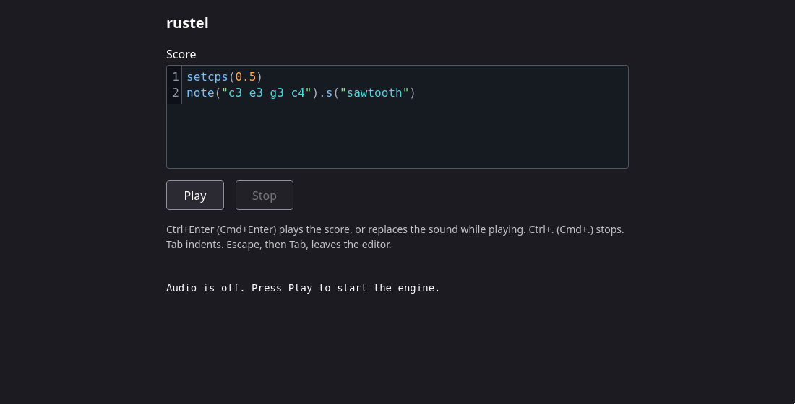

# rustel-webapp

rustel in your browser. Type a score, press Ctrl+Enter, hear the pattern.

It's still early but here is a screenshot of what it looks like so far:


A score is JavaScript of the pattern language. Edit the score while the sound
runs and press Ctrl+Enter again. The new pattern takes over 8 ms later and
keeps the beat.

```js
setcps(0.5)
note("c3 e3 g3 c4").s("sawtooth")
```

The engine is [rustel](https://github.com/tzfm/rustel), compiled to
WebAssembly. No server makes the sound. Your browser runs the pattern engine in
a Worker and the synth in an AudioWorklet. The first load is about 1 MB.

## Try the page

You need Node 24, Rust 1.98.1 with the `wasm32-unknown-unknown` target, and
Firefox.

```sh
npm ci --ignore-scripts
node scripts/dev.ts
```

Open `http://127.0.0.1:8080/` in Firefox. Chrome plays too.

## Keys

| Key | Action |
| --- | --- |
| Ctrl+Enter or Cmd+Enter | Play the score, or replace the sound while the score plays |
| Ctrl+. or Cmd+. | Stop |
| Tab, Shift+Tab | Indent and dedent by two spaces |
| Escape, then Tab | Leave the editor |

## What works today

- Scores with the pattern functions of the engine, `register`, and your own
  functions inside a pattern.
- The built-in waveforms (`sine`, `sawtooth`, `square`, `triangle`) and one
  sample, `bd`.
- 1,472 of the 1,479 test scores of the engine give the same events as native
  rustel.
- A score runs in a sandbox: a frame on a second site, and a Worker with no
  network and no storage.
- A score which hangs does not stop the music. A standby Worker takes over
  after about 1 s and plays the last good score.

Not yet: other samples, reverb, visuals, MIDI, named scales.
[Issue 1](https://github.com/tzfm/rustel-webapp/issues/1) lists the next
steps.

## How the page is built

```text
app page                   engine frame, on a second site
+----------------+         +---------------------------------------+
| editor         |  score  | Worker: transpile, evaluate, schedule |
| Play, Stop     | ------> |      | events, up to 2 s ahead        |
| status line    | <------ |      v                                |
+----------------+ status  | AudioWorklet: render 128 frames       |
                           +---------------------------------------+
```

Three wasm modules do the work: the pattern engine (523 KB), the score
transpiler (243 KB) and the audio renderer (138 KB). Sizes are at brotli 11.

[docs/design.md](docs/design.md) has the details: the parts, the recovery, the
headers a host must send, and the limits.

## Check a change

```sh
scripts/gate
```

The gate runs every check: the Rust tests, the type check, the 1,479 scores,
the size budget and a silent browser test in headless Firefox. Read
[CONTRIBUTING.md](CONTRIBUTING.md) before you change code.

## Licence

AGPL-3.0-or-later. See [LICENSE](LICENSE) and [NOTICE.md](NOTICE.md).
